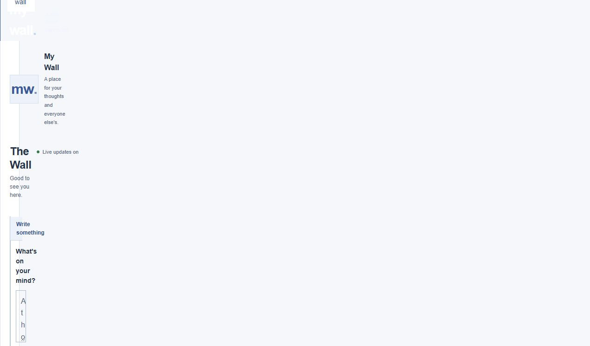

# My Wall

A 2008-style public wall built for [Test 2: My Wall React App](https://tremendous-tiger-a4a.notion.site/Test-2-My-Wall-React-App-22300bbdfc3b804491bbf6d7f2481cd8).

Write a message, press **Share**, and see it appear on everyone's wall. Posts live in Supabase and remain after refresh. No account is needed.



## Run locally

Use Node.js 24. This checkout already has a configured, ignored `.env.local` for the `my-wall` Supabase project.

```powershell
npm ci
npm run dev
```

Open http://127.0.0.1:3000. For another checkout, copy `.env.example` to `.env.local` and follow [setup and deployment](docs/SETUP.md).

## Features

- Anonymous messages up to 280 Unicode code points, including emoji.
- Newest-first feed, with 50 posts initially and a button to load older messages.
- Supabase Realtime inserts, deduplication, and refresh after reconnection.
- Accessible labels, keyboard focus, posting status, loading/empty/error states, and retained drafts on failure.
- Database constraints and RLS: public read and message-only insert; no visitor editing, deletion, author override, or timestamp override.
- Responsive layout and reduced-motion support.

Stack: React 19, Next.js App Router, TypeScript, Supabase, Tailwind CSS, and an adapted shadcn/ui Textarea.

## Verify

```powershell
npm test
npm run typecheck
npm run build
npm run test:database
```

The database smoke check creates one visible diagnostic post and prints its ID. It intentionally uses public credentials that cannot delete posts. An administrator can remove that exact diagnostic row afterward. See [verification results and manual checks](docs/TESTING.md).

Build and dev scripts use Next.js's supported `--webpack` option because Turbopack's CSS worker crashed on this Windows machine. The production build passed with webpack.

## Guides

- [Supabase setup, local development, GitHub, Vercel, and submission](docs/SETUP.md)
- [Test results and remaining checks](docs/TESTING.md)

## Scope

Messages are public, with the fixed author **Wall Visitor**. Authentication, uploads, likes, and comments are outside this challenge. Anonymous insertion has no application rate limit or moderation; add abuse controls before promoting the wall broadly.

Commits follow the [requested cheatsheet](https://gist.github.com/qoomon/5dfcdf8eec66a051ecd85625518cfd13), without coauthor trailers. Work lives on `feature/my-wall`, following [Conventional Branch](https://conventionalbranch.org/).
